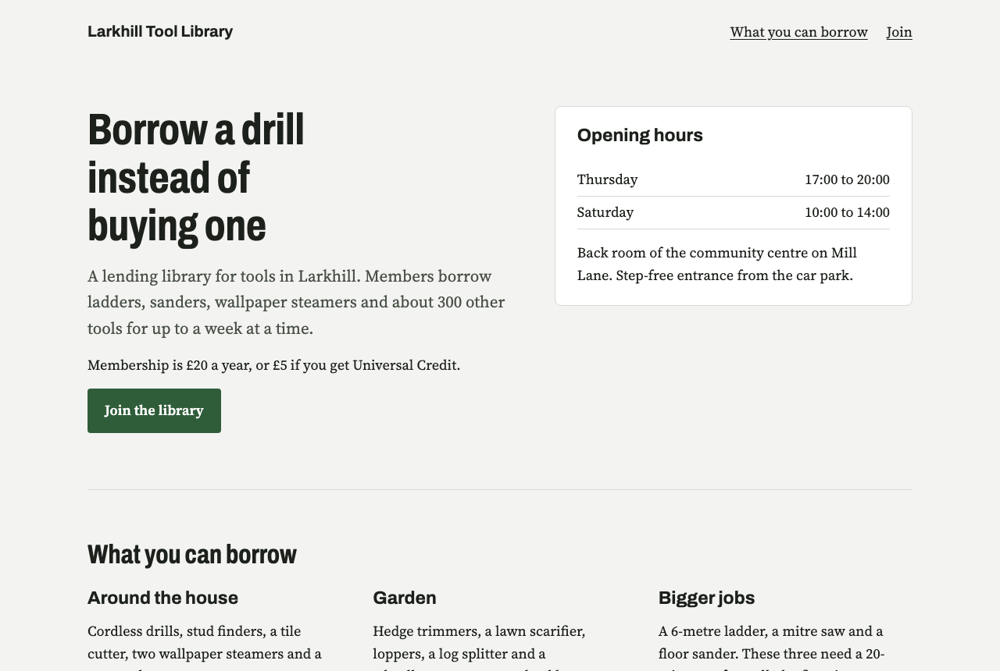
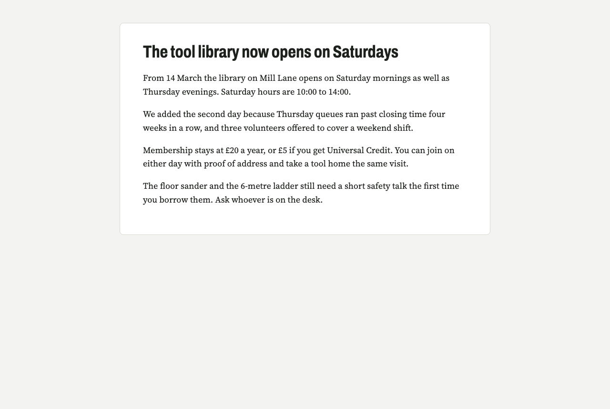

# slop-guard

Rules for spotting the habits that make AI-made work look generic, and a small checker that finds the ones a machine can see. It covers web pages, app screens, decks, documents, copy, images and code. Each context gets its own rules.

The checker is one Node file with no dependencies. It reads HTML, CSS, Markdown, plain text, and JavaScript, TypeScript and Python source. A hit is evidence for a reviewer, not a verdict. The rules are preferences about design and writing. They are not a test of who or what made something.

<picture>
  <source media="(prefers-color-scheme: dark)" srcset="docs/flow-dark.svg">
  
</picture>

## Install

**As a Claude Code skill.** Clone it into your skills folder:

```sh
git clone https://github.com/blisse-code/slop-guard ~/.claude/skills/slop-guard
```

**With the skills CLI**, for Claude Code and other agents:

```sh
npx skills add blisse-code/slop-guard
```

**As a command**, with nothing installed:

```sh
npx github:blisse-code/slop-guard page.html --context web
```

**With plain Node** (version 20 or later), from a clone:

```sh
node check-slop.mjs page.html --context web
```

## Use

```sh
node check-slop.mjs <files or folders> --context <web|app|deck|doc|copy|image|code>
                    [--pairing type-pairing.md] [--json out.json] [--strict] [--year 2026]
node check-slop.mjs --list --context app      # the rules for one context
node check-slop.mjs --rubric --context doc    # only the rows you check by eye
node check-slop.mjs src --context code         # a code change in JS, TS or Python
```

`--strict` exits with code 1 when there is a high-severity finding, so you can use it in CI. `--pairing` checks that a type pairing was chosen and written down before the build started (see `SKILL.md`).

## Contexts

| Context | Use it for |
|---|---|
| `web` | Websites, landing pages, portfolios |
| `app` | App and dashboard UI, HTML prototypes |
| `deck` | Decks and slides |
| `doc` | Research reports, briefs, write-ups |
| `copy` | Social posts, captions, emails, ads |
| `image` | Generated or chosen imagery |
| `code` | Code changes in JavaScript, TypeScript and Python |

<picture>
  <source media="(prefers-color-scheme: dark)" srcset="docs/contexts-dark.svg">
  
</picture>

All 169 rules, by context: [RULES.md](RULES.md).

Text people read on a page uses curly quotes and apostrophes. Code, Markdown source, commands and attributes keep straight ones. The checker flags straight quotes only in the visible text of HTML.

## Examples

Each example has a sloppy version and a clean version of the same content. The checker's text and JSON output sits next to each file. The screenshots were taken in a headless browser.

### Landing page

| Before: 77 findings | After: 0 findings |
|---|---|
|  |  |

[sloppy.html](examples/landing/sloppy.html) · [its findings](examples/landing/sloppy.txt) · [clean.html](examples/landing/clean.html) · [type pairing](examples/landing/type-pairing.md)

### Dashboard

| Before: 41 findings | After: 0 findings |
|---|---|
|  |  |

[sloppy.html](examples/dashboard/sloppy.html) · [its findings](examples/dashboard/sloppy.txt) · [clean.html](examples/dashboard/clean.html) · [type pairing](examples/dashboard/type-pairing.md)

### Post

| Before: 31 findings | After: 0 findings |
|---|---|
|  |  |

[sloppy.md](examples/writing/sloppy.md) · [its findings](examples/writing/sloppy.txt) · [clean.md](examples/writing/clean.md)

What the checker prints on the sloppy post:

<picture>
  <source media="(prefers-color-scheme: dark)" srcset="docs/terminal-dark.svg">
  
</picture>

### Code

The same overdue-loan reminder written twice in JavaScript. Before: 21 findings. After: 0 findings.

[sloppy.js](examples/code/sloppy.js) · [its findings](examples/code/sloppy.txt) · [clean.js](examples/code/clean.js) · [its findings](examples/code/clean.txt)

```text
HIGH   code-swallowed-errors sloppy.js:21  An empty catch block hides the failure: handle it, or say in a comment why it is safe to ignore.
HIGH   code-todo-residue    sloppy.js:56  Placeholder left where code should be.
MEDIUM code-unused-imports  sloppy.js:2  "writeFile" is imported and never used.
MEDIUM code-dead-code       sloppy.js:42  2 lines of commented-out code: delete them, version control keeps them.
LOW    code-narrating-comments sloppy.js:50  A comment that says what the next line plainly does: delete it, or say why instead.
```

The checker only sees what is in the files. Layout, imagery and tone still need a person. `node check-slop.mjs --rubric --context web` lists what to look at.

## Add a rule

1. Add the rule to `rules.json`: an `id`, the pattern to avoid (`dont`), what to do `instead`, its `contexts`, how to `check` it, a `severity`, and a `detector` name if the checker can find it.
2. For a detector, add the code to `check-slop.mjs`. Then plant the pattern in `tests/check-slop.test.mjs`, with a clean case that must stay quiet.
3. Bump `version` in `rules.json` and regenerate the list: `node check-slop.mjs --rules-md > RULES.md`.
4. Run `node --test tests/check-slop.test.mjs`. CI runs the same tests on Node 20, 22 and 24, and checks that `RULES.md` matches `rules.json`.

To rebuild the screenshots and diagrams: `sh examples/run-checks.sh` refreshes the checker output, and `node docs/build-docs.mjs` redraws the diagrams.

## Sources

The rules draw on several sources:

- Chiranjeet Banerjee's own anti-slop and type pairing rules
- [Impeccable](https://github.com/pbakaus/impeccable), Apache-2.0
- [taste-skill](https://github.com/Leonxlnx/taste-skill), MIT
- [ui-ux-pro-max](https://github.com/nextlevelbuilder/ui-ux-pro-max-skill), MIT
- The de-slop skill in [iamladi's primitives plugin](https://github.com/iamladi/cautious-computing-machine--primitives-plugin), MIT
- Ideas from [deslop-skills](https://github.com/kmaida/deslop-skills) and from the de-slop skill in [shipshitdev/skills](https://github.com/shipshitdev/skills), rewritten in our own words
- General UI, accessibility, code review and plain-writing practice

If you use those tools too, slop-guard is the quick gate and they are the deeper passes. See `SKILL.md` for how they fit together.

## Licence

Apache-2.0. See [LICENSE](LICENSE) and [NOTICE](NOTICE).
