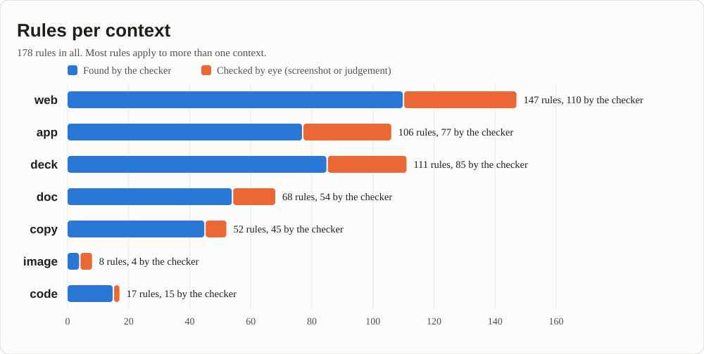
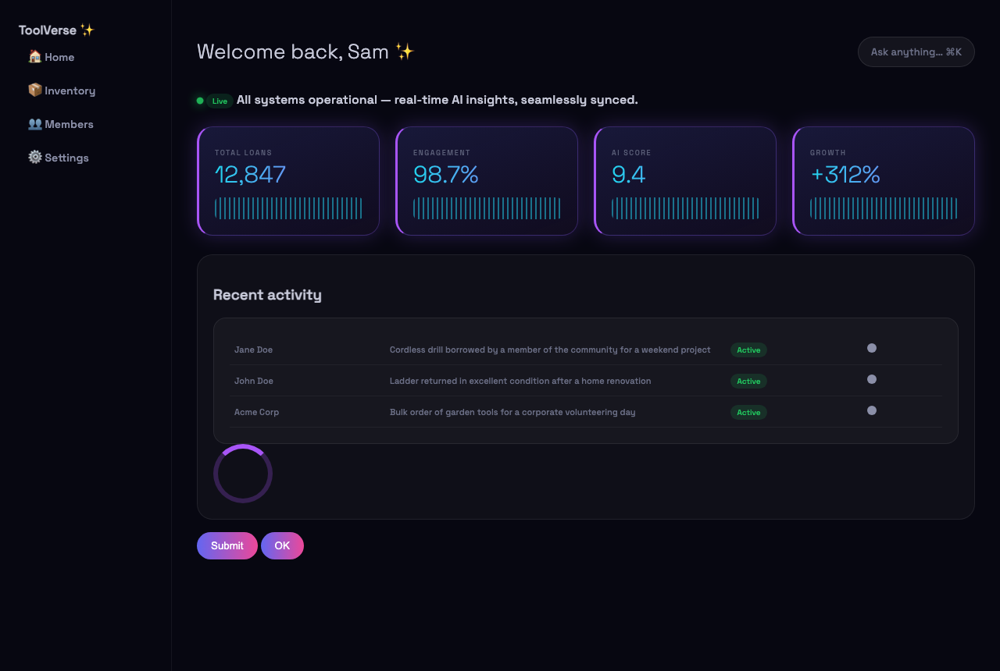
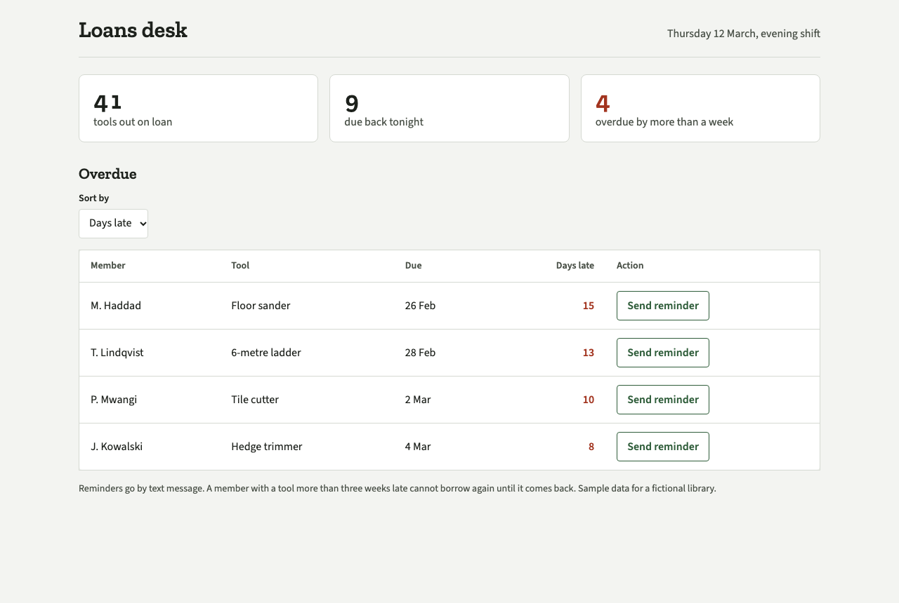
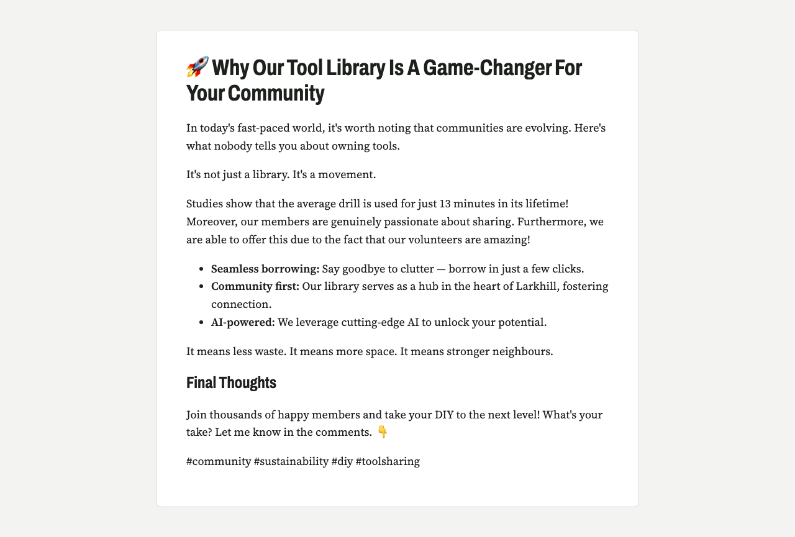
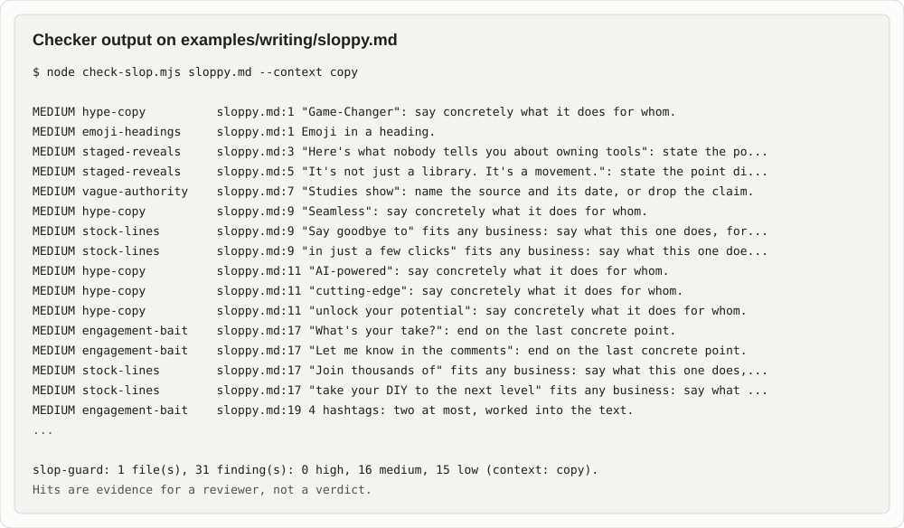

# slop-guard

Rules for spotting the habits that make AI-made work look generic, and a small checker that finds the ones a machine can see. It covers web pages, app screens, decks, documents, copy, images and code. Each context gets its own rules.

The checker is one Node file with no dependencies. It reads HTML, CSS, SVG, Markdown, plain text, and JavaScript, TypeScript and Python source, or text piped in. A hit is evidence for a reviewer, not a verdict. The rules are preferences about design and writing. They are not a test of who or what made something.

<picture>
  <source media="(prefers-color-scheme: dark)" srcset="docs/flow-dark.svg">
  
</picture>

## Install

**As a Claude Code skill.** Clone it into your skills folder:

```sh
git clone https://github.com/blisse-code/slop-guard ~/.claude/skills/slop-guard
```

**With the skills CLI**, for Claude Code and other agents:

```sh
npx skills add blisse-code/slop-guard
```

**As a command**, with nothing installed:

```sh
npx github:blisse-code/slop-guard page.html --context web
```

**With plain Node** (version 20 or later), from a clone:

```sh
node check-slop.mjs page.html --context web
```

## Use

```sh
node check-slop.mjs <files or folders> --context <web|app|deck|doc|copy|image|code>
                    [--genre <genre>] [--profile profile.json] [--history scores.jsonl]
                    [--pairing type-pairing.md] [--json out.json] [--strict | --fail-on hard] [--year 2026]
node check-slop.mjs --list --context app      # the rules for one context
node check-slop.mjs --rubric --context doc    # only the rows you check by eye
node check-slop.mjs --genres                  # the genres and what each one relaxes
node check-slop.mjs src --context code         # a code change in JS, TS or Python
git log -1 --format=%B | node check-slop.mjs --stdin --context doc   # a commit message
node check-slop.mjs post.md --context copy --git-base HEAD           # what an edit added, fixed and changed
node check-slop.mjs --build-voice my-posts/ > voice.json              # a voice from someone's own writing
node check-slop.mjs draft.md --context copy --voice voice.json
gh pr view 12 --json body -q .body | node check-slop.mjs --stdin --context doc
```

`--strict` exits with code 1 when there is a high-severity finding, so you can use it in CI. `--fail-on hard` fails only on hard findings, and `--fail-on medium` on anything medium or worse. `--pairing` checks that a type pairing was chosen and written down before the build started (see `SKILL.md`).

## Fewer false alarms

- **Quoted, cited and code text is skipped.** The prose checks ignore text in quotation marks, code blocks and inline code, blockquotes and links, so a report that quotes "unlock your potential" to criticise it is not flagged for it. Mark any other region with `<!-- slop-guard: off -->` and `<!-- slop-guard: on -->`, or a whole file with `<!-- slop-guard: ignore-file -->`.
- **Literal senses are kept.** "Elevated blood pressure", "seamless steel tubes", "the engine's flywheel", "the company name on the invoice" and "studies show (Lee et al., 2021)" pass, while "elevate your brand" and "our growth flywheel" are still flagged.
- **A false-alarm set.** Public-domain prose (Lincoln, Austen, Thoreau, Dickens and others, in `tests/fixtures/public-domain/`) must raise nothing at medium or above. A new prose rule ships only when it stays quiet there.

## Beyond single words

- **How the ideas are arranged.** In documents, slop-guard flags an ending that restates the opening, and the "say what you'll say, say it, say what you said" pattern: an introduction that lists every section, with an ending that repeats it.
- **Claims with no source.** "The fastest platform", "proven to", "award-winning" and figures like "40% faster" are flagged unless the sentence, or the next one, names or links a source. Figures also pass when the document has a Sources or References section.
- **The same sentence across a site.** When you check a folder, a sentence on three or more pages or documents is flagged. Navigation, headers, footers and asides are left out, because they repeat by design.
- **Text outside the page body.** Alt text, titles, labels and meta descriptions in HTML, the text in SVG files, words in JSX and TSX components, and anything piped in with `--stdin` (commit messages, pull request descriptions) all get the prose checks.

## Edits, voice and reading level

- **Diff mode.** `--before old.md` (one file) or `--git-base <rev>` (each file against git) reports which findings an edit added, which it fixed and which stayed. It also checks that the facts survived: figures that disappeared or appeared, names that were dropped, and a change in the number of negations (not, no, never, without), any of which can flip a meaning.
- **Voice.** `--build-voice <files or folders>` measures writing a person did themselves: sentence and paragraph lengths, punctuation, pronouns, contractions and common function words. Use `--split '^## '` to treat each section of one file as its own sample. `--voice voice.json`, or `"voice"` in a profile, compares a draft with it. You get a 0–100 match and a `voice-drift` finding that names the features furthest from the samples. The voice file holds numbers and function words only, never sentences or content words. A match score is a guide to drafting, not proof of who wrote something. Keep a person's samples and voice file private. [examples/voice/](examples/voice/) shows a made-up writer.
- **Reading grade by context.** Prose of 60 words or more gets a Flesch-Kincaid grade. Copy and web pages aim for grade 9 or below, decks 10 and documents 13, and a profile can set its own (`"readingGrade": { "copy": 7 }`). Legal, clinical, academic and fiction writing are left out.
- **Spelling.** A profile with `"spelling": "en-GB"` or `"en-US"` flags words spelled the other way: colour or color, organise or organize, centre or center, and about 60 more pairs with one clear meaning each.

## Genres, profiles, hard and soft

- **Genres** relax rules that do not fit a kind of writing: hedges are right in legal and clinical text, repetition is right in a speech, and FAQ headings are right in docs. Pass `--genre social|email|docs|legal|clinical|academic|fiction|speech`.
- **Profiles** are optional JSON files that tune the checker for a team, brand or writer: switch rules off, change severities, allow words, ban others. Without one, the neutral defaults apply. See [profiles/](profiles/README.md) for the keys and four generic examples.
- **Hard and soft.** Every rule is one or the other. Hard rules are wrong in any voice (placeholder text, made-up proof, unreadable type), so profiles and genres cannot switch them off without saying so. Soft rules are style defaults that a voice may override.

## Trend score

Each file of prose with 150 words or more gets a 0–100 trend score, weighted by severity and by length. Use it to watch one piece of work improve across drafts, with `--history scores.jsonl` to record runs and show the change since the last one. It is not a grade, and it does not compare one writer with another. Short texts get no score, because a couple of findings would swing it wildly.

## Contexts

| Context | Use it for |
|---|---|
| `web` | Websites, landing pages, portfolios |
| `app` | App and dashboard UI, HTML prototypes |
| `deck` | Decks and slides |
| `doc` | Research reports, briefs, write-ups |
| `copy` | Social posts, captions, emails, ads |
| `image` | Generated or chosen imagery |
| `code` | Code changes in JavaScript, TypeScript and Python |

<picture>
  <source media="(prefers-color-scheme: dark)" srcset="docs/contexts-dark.svg">
  
</picture>

All 186 rules, by context: [RULES.md](RULES.md).

Text people read on a page uses curly quotes and apostrophes. Code, Markdown source, commands and attributes keep straight ones. The checker flags straight quotes only in the visible text of HTML.

## Examples

Each example has a sloppy version and a clean version of the same content. The checker's text and JSON output sits next to each file. The screenshots were taken in a headless browser.

### Landing page

| Before: 78 findings | After: 0 findings |
|---|---|
|  |  |

[sloppy.html](examples/landing/sloppy.html) · [its findings](examples/landing/sloppy.txt) · [clean.html](examples/landing/clean.html) · [type pairing](examples/landing/type-pairing.md)

### Dashboard

| Before: 41 findings | After: 0 findings |
|---|---|
|  |  |

[sloppy.html](examples/dashboard/sloppy.html) · [its findings](examples/dashboard/sloppy.txt) · [clean.html](examples/dashboard/clean.html) · [type pairing](examples/dashboard/type-pairing.md)

### Post

| Before: 31 findings | After: 0 findings |
|---|---|
|  |  |

[sloppy.md](examples/writing/sloppy.md) · [its findings](examples/writing/sloppy.txt) · [clean.md](examples/writing/clean.md)

What the checker prints on the sloppy post:

<picture>
  <source media="(prefers-color-scheme: dark)" srcset="docs/terminal-dark.svg">
  
</picture>

### Code

The same overdue-loan reminder written twice in JavaScript. Before: 21 findings. After: 0 findings.

[sloppy.js](examples/code/sloppy.js) · [its findings](examples/code/sloppy.txt) · [clean.js](examples/code/clean.js) · [its findings](examples/code/clean.txt)

```text
HIGH   code-swallowed-errors sloppy.js:21  An empty catch block hides the failure: handle it, or say in a comment why it is safe to ignore.
HIGH   code-todo-residue    sloppy.js:56  Placeholder left where code should be.
MEDIUM code-unused-imports  sloppy.js:2  "writeFile" is imported and never used.
MEDIUM code-dead-code       sloppy.js:42  2 lines of commented-out code: delete them, version control keeps them.
LOW    code-narrating-comments sloppy.js:50  A comment that says what the next line plainly does: delete it, or say why instead.
```

The checker only sees what is in the files. Layout, imagery and tone still need a person. `node check-slop.mjs --rubric --context web` lists what to look at.

## Add a rule

1. Add the rule to `rules.json`: an `id`, the pattern to avoid (`dont`), what to do `instead`, its `contexts`, how to `check` it, a `severity`, whether it is `hard` or `soft` (`kind`), and a `detector` name if the checker can find it.
2. For a detector, add the code to `check-slop.mjs`. Then plant the pattern in `tests/check-slop.test.mjs`, with a clean case that must stay quiet.
3. Bump `version` in `rules.json` and regenerate the list: `node check-slop.mjs --rules-md > RULES.md`.
4. Run `node --test tests/check-slop.test.mjs`. CI runs the same tests on Node 20, 22 and 24, and checks that `RULES.md` matches `rules.json`.

To rebuild the screenshots and diagrams: `sh examples/run-checks.sh` refreshes the checker output, and `node docs/build-docs.mjs` redraws the diagrams.

## Sources

The rules draw on several sources:

- Chiranjeet Banerjee's own anti-slop and type pairing rules
- [Impeccable](https://github.com/pbakaus/impeccable), Apache-2.0
- [taste-skill](https://github.com/Leonxlnx/taste-skill), MIT
- [ui-ux-pro-max](https://github.com/nextlevelbuilder/ui-ux-pro-max-skill), MIT
- The de-slop skill in [iamladi's primitives plugin](https://github.com/iamladi/cautious-computing-machine--primitives-plugin), MIT
- Ideas from [deslop-skills](https://github.com/kmaida/deslop-skills) and from the de-slop skill in [shipshitdev/skills](https://github.com/shipshitdev/skills), rewritten in our own words
- General UI, accessibility, code review and plain-writing practice

If you use those tools too, slop-guard is the quick gate and they are the deeper passes. See `SKILL.md` for how they fit together.

## Licence

Apache-2.0. See [LICENSE](LICENSE) and [NOTICE](NOTICE).
